<!-- ============================================================
  Y2K / PIXEL / RETRO PROFILE README  ·  aashnology
  Search for [[ FILL ME ]] and replace those bits with your real info.
  Palette: hot pink #ff2e97 · mint #39ff88 · periwinkle #7b6cff · star yellow #f7e26b
============================================================= -->

<div align="center">


<br/>


-ff2e97?style=for-the-badge&labelColor=000000)


</div>


<div align="center">

</div>

---

## ✦ LEVEL 01 · MEET THE PLAYER

<div align="center">

</div>

I've been a hardcore Spotify & Pinterest kinda girlie since 2019. I read Wrapped like scripture and curate playlists like a second language. Now I build tools that analyze, understand, and personalize my own musical and aesthetic doom-scrolling, using **vibe coding + machine learning**.

---

## ✦ WEAPONS MASTERY (TECH STACK)

<div align="center">

**MAIN WEAPONS**<br/>


**ANALYST LOADOUT**<br/>


**SIDE WEAPONS**<br/>


</div>


<div align="center">

</div>

---

## ✦ SKILLS MASTERY

```text
 DATA & ANALYSIS
  • [[ FILL ME ]]   e.g. EDA, SQL querying, statistics
  • [[ FILL ME ]]   e.g. data visualization
 MACHINE LEARNING
  • [[ FILL ME ]]   e.g. recommendation systems, classification
 DOMAIN
  • Bioinformatics
  • Music & recommendation-system thinking
  • Product analytics (learning)
```

---

## ✦ TRAINING LOG

```text
 > B.Tech, Bioinformatics & Data Science
 > [[ FILL ME ]] University / College
 > [[ FILL ME ]] 20XX – 20XX
```


<div align="center">

</div>

---

## ✦ MISSIONS (PROJECTS)

<div align="center">

| 🎮 Quest | 📜 What it does | 🧰 Loot (stack) | Status |
|:--|:--|:--|:--:|
| **[[ FILL ME: project name ]]** | [[ FILL ME: one line, what problem it solves ]] | [[ FILL ME ]] | 🟢 / 🟡 / ✅ |
| **[[ FILL ME: project name ]]** | [[ FILL ME ]] | [[ FILL ME ]] | [[ FILL ME ]] |
| **[[ FILL ME: project name ]]** | [[ FILL ME ]] | [[ FILL ME ]] | [[ FILL ME ]] |

</div>

---

## ✦ QUEST LOG · WHERE I'M HEADING

```text
 [■■■□□]  MAIN QUEST     : Data Analyst at Spotify / Pinterest
 [■□□□□]  SIDE QUEST     : [[ FILL ME ]]  e.g. build a Spotify listening-habits analyzer
 [□□□□□]  FUTURE QUEST   : [[ FILL ME ]]  e.g. internships, certifications, open source
 
 CURRENTLY LEARNING : [[ FILL ME ]]
 CURRENTLY BUILDING : [[ FILL ME ]]
```


<div align="center">

</div>

---

## ✦ PLAYER STATS

<div align="center">


</div>

---

## ✦ SAVE POINT · CONNECT WITH ME

<div align="center">

[](https://www.linkedin.com/in/aashnadataanalyst)

<!-- optional:  -->
<!-- optional:  -->

<br/>


</div>
